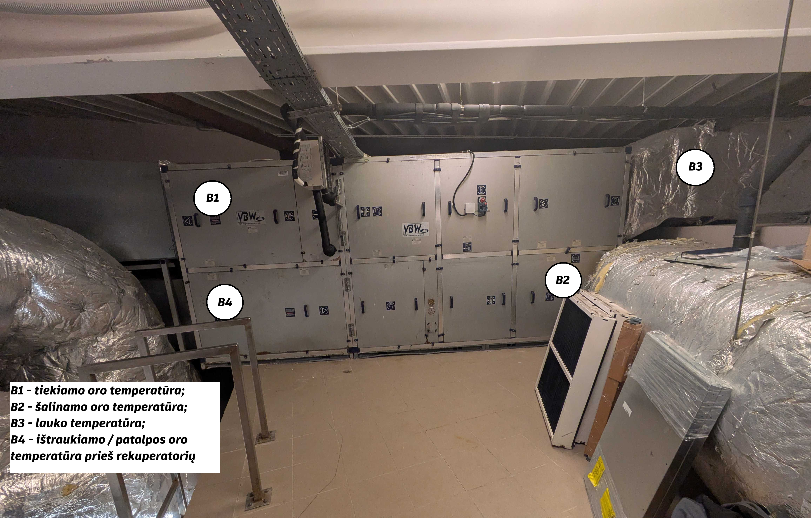

# Vėdinimo įrangos elementų identifikavimas ir lokacija

Kadangi arenos (OŠP1, OŠP2) ir gyvenamųjų baseinų (OŠP3) vėdinimo įrenginių konstrukciniai parametrai yra analogiški, visa tolesnė apžvalga ir aprašymas pateikiami remiantis OŠP3 modelio pavyzdžiu.

## Temperatūros jutikliai 

### Rekuperacinės sistemos temperatūros jutiklių analizė

| Jutiklis | Pavadinimas | Techninė paskirtis ir reikšmė |
|:---:|---|---|
| **B1** | **SUPPLY SENSOR** (Tiekiamo oro jutiklis) | Matuoja švaraus oro, tiekiamo į patalpas (areną, baseino zoną ar kitas patalpas), temperatūrą po rekuperatoriaus ir šildytuvo. Tai pagrindinis parametras, pagal kurį automatikos sistema reguliuoja tiekiamo oro temperatūrą ir palaiko nustatytą mikroklimatą. |
| **B2** | **EXHAUST SENSOR** (Šalinamo oro jutiklis) | Matuoja į lauką šalinamo oro temperatūrą po to, kai oras praeina per rekuperatorių. Pagal šio jutiklio rodmenis galima įvertinti šalinamame ore likusią šilumą ir jos perdavimo procesą rekuperatoriuje. |
| **B3** | **EXTERNAL SENSOR** (Lauko oro jutiklis / ODA) | Matuoja lauko oro temperatūrą prieš jam patenkant į įrenginį. Šie duomenys naudojami rekuperacijos efektyvumui apskaičiuoti, apledėjimo rizikai įvertinti ir apsaugos funkcijoms valdyti, pavyzdžiui, apėjimo sklendei (*Bypass*) ar pašildytuvui. |
| **B4** | **RECOV. SENS** (Ištraukiamo patalpos oro jutiklis prieš rekuperatorių) | Matuoja iš patalpų ištraukiamo oro temperatūrą prieš jam patenkant į šilumokaitį. Kartu su B2 ir B3 jutiklių rodmenimis šis parametras naudojamas rekuperatoriaus šiluminio efektyvumo koeficientui apskaičiuoti. |

